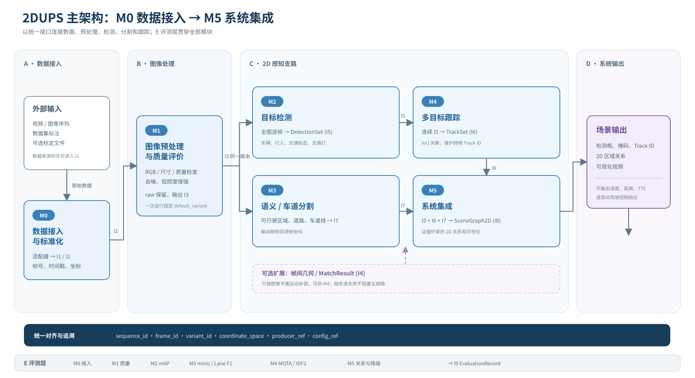

# 2DUPS · 单目 RGB 道路视频的 2D 感知原型

项目目标是把单目 RGB 道路视频整理为可复用的 2D 感知链路：数据接入、图像预处理、目标检测、语义/车道分割、多目标跟踪、系统集成，以及独立评测层。系统不输出真实距离、深度、TTC、碰撞风险、规划或控制结论。



当前实现状态：

- M0：BDD100K 五段视频流式解码、KITTI Road 单图与标定接入可用；KITTI 当前只通过合成数据测试，其他数据集适配器待补齐。
- M1：RGB 校验、质量评价、去噪和 CLAHE 低照度增强可用，阈值仍是初始值。
- M2：官方 YOLO11n 检测适配器可用，已在一台服务器验证真实 GPU 推理，未做精度评测。
- M3：语义/车道分割接口和配置骨架已建立，算法待接入。
- M4：已接入 Ultralytics BoT-SORT 稳定配置及 ByteTrack 基线，输出 I6；支持背景运动补偿、车辆细类稳定与丢失恢复，尚未进行正式跟踪评测。
- M5、E：接口和配置骨架已建立，算法和指标实现待补齐。

## 开始开发

每位成员在自己的 Linux x86_64 服务器上独立 clone 仓库、创建项目专用环境、取得数据和权重。仓库内不写服务器绝对路径，也不依赖其他成员的服务器或 Conda 环境。

```bash
git clone https://github.com/saturn756/2DUPS.git
cd 2DUPS
conda env create -f environment.yml
conda activate 2dups
python -m pip install -r requirements-lock-linux-py311.txt
python -m pip install --no-deps -e .
python -m pip check
python -m pytest -q
```

获取五段 BDD100K 视频和对应 JSON 的命令见[样本说明](docs/datasets/08_BDD100K_五段小样本.md)。数据放在 `data/raw/bdd100k/`，不进入 Git；取得后先校验：

```bash
sha256sum -c configs/datasets/bdd100k-five.sha256
python scripts/run_dataloader.py --sample-id 359ce11c-e2f58b33 --max-frames 30
python scripts/run_m1_preprocess.py --sample-id 359ce11c-e2f58b33 --max-frames 20
```

完整的五段数据接入检查：

```bash
python scripts/run_dataloader.py
python scripts/run_m1_preprocess.py --max-frames 320 --stride 100
```

## M0 → M1 → M2 检测冒烟链路

M2 配置固定了官方 YOLO11n 权重的仓库相对路径和 SHA-256。权重不提交 Git；每台服务器按[协作规范](docs/team/01_协作开发与复现规范.md)分别取得并核对。

```bash
python scripts/run_m2_detection.py --sample-id 359ce11c-e2f58b33 --max-frames 3
python scripts/run_m2_detection.py --sample-id 359ce11c-e2f58b33 --start-frame 302 --max-frames 1 --json
```

第二条命令输出 I5 JSON，用于检查真实检测框和接口对齐，不计算准确率。`python scripts/run_pipeline.py --module-config configs/m2_detection.yaml --dry-run` 只解析配置。

## 检测与稳定跟踪

```bash
python scripts/run_m4_tracking.py --sample-id 359ce11c-e2f58b33 --max-frames 300 --output outputs/tracking/coco-demo
python scripts/run_m4_tracking.py --sample-id 359ce11c-e2f58b33 --detection-config configs/m2_detection_bdd100k.yaml --max-frames 300 --output outputs/tracking/bdd-demo
```

输出目录必须是仓库内的新目录，包含 `tracking.mp4`、I5/I6 JSONL、`motion.jsonl` 和有效配置。默认使用 `configs/m4_tracking_stable.yaml`：BoT-SORT（无需 ReID 权重）、背景光流运动补偿，车辆 car/truck/bus 共用关联组，最近 5 次观测进行分数加权类别投票（至少 3 票才切换）。使用锁定的 Ultralytics 8.3.184 与 `lap==0.5.12`，无新增依赖。跟踪入口保留 0.10 以上的检测用于低分恢复，新建轨迹阈值为 0.25，丢失缓冲为 45 帧；最近 5 个输出帧中至少 3 次高分匹配后确认 ID，候选框灰色显示。视频框使用 alpha=0.65 的因果平滑，I5/I6 框不被显示层修改。原有检测入口及 M0/M1 不变。

使用 `--tracking-config configs/m4_tracking.yaml` 可运行原 ByteTrack 基线（逐类关联、新建阈值 0.25、无运动补偿或显示平滑）。

BDD100K 微调权重按 `configs/m2_detection_bdd100k.yaml` 的路径与哈希单独取得：

```bash
mkdir -p checkpoints/m2_detection/yolo11n-bdd100k/v1
curl -fL https://huggingface.co/dronefreak/bdd100k-yolo11n/resolve/2b5554133522f96f50ce87a4df0a2de556e4b7ad/best.pt -o checkpoints/m2_detection/yolo11n-bdd100k/v1/best.pt
sha256sum checkpoints/m2_detection/yolo11n-bdd100k/v1/best.pt
```

M4 必须逐帧调用，运行时 `frame_index` 来自 I2；跳帧或倒序会被拒绝。序列切换、图像版本、坐标、尺寸或类别模式改变会重置关联。丢失轨迹仅输出状态和历史检测引用，不绘制旧框。稳定版另传与 I5 同版本的 RGB，在移动目标框外估计背景运动；光流、RANSAC 或运动幅度检查失败时使用单位变换并记录原因。该图像平面补偿在 M4 内计算，不生成或使用外部 I4，不改变输入图像。首帧/版本切换不补偿；`motion.jsonl` 记录帧对、矩阵和质量诊断，I6 只在实际采用有效估计时标记补偿。仍未使用 ReID，单一全局变换不能消除深度视差，KITTI Road 独立图片不能用于跟踪验证。

## KITTI Road 图片输入

按 KITTI 原始目录准备 `data/raw/kitti_road/training/` 下的 `image_2/`、`gt_image_2/` 和 `calib/`，再运行：

```bash
python scripts/make_kitti_road_manifest.py
python scripts/run_m1_preprocess.py --manifest data/raw/kitti_road/manifest.yaml --sample-id um_000000 --max-frames 1
python scripts/run_m2_detection.py --manifest data/raw/kitti_road/manifest.yaml --sample-id um_000000 --max-frames 1
```

每张图片独立成样本，不提供视频时序或跟踪真值。检测仍用当前 M2 权重，不读取道路真值掩码。`evaluation/kitti_road.py` 仅提供本地图像平面的二值指标辅助，不等同于官方 BEV 评测或完整 E 层。通用自采视频入口尚未实现。

## 维护入口

| 内容 | 权威位置 |
|---|---|
| 协作者进入项目后的操作和检查 | [AGENTS.md](AGENTS.md) |
| M0–M5 主链路、模块职责和降级 | [模块规范](docs/architecture/02_模块规范.md) |
| I1–I9 字段、JSON 示例和对齐规则 | [接口规范](docs/interface/04_接口规范.md) + `src/twodups/contracts/` |
| 环境、数据、checkpoint 和协作约定 | [协作与复现规范](docs/team/01_协作开发与复现规范.md) |
| 当前 BDD100K 样本与下载方法 | [BDD100K 五段样本](docs/datasets/08_BDD100K_五段小样本.md) |
| 当前模块参数 | `configs/` |

`docs/reference/` 是历史调研，不作为当前实现要求。数据、权重、日志和输出均放在被 Git 忽略的目录中。

许可证见 [LICENSE](LICENSE)。

## 检测跟踪第一轮工程调参

已完成 5 个来源视频、10 个片段的对照；6 段调参、4 段来源隔离验证，白天固定 raw、夜间保留 M1 输出。暂定新建阈值 0.25、缓冲 45 帧，提高了检测保留，尚未证明身份准确率改善。[样本、参数与结果](docs/experiments/09_检测跟踪工程调参.md)。raw 策略仅用于实验，不修改 M0/M1 产品入口。

可选较大 COCO 预训练模型（未替换默认权重）：

```bash
mkdir -p checkpoints/m2_detection/yolo11m/v1
curl -fL https://github.com/ultralytics/assets/releases/download/v8.3.0/yolo11m.pt -o checkpoints/m2_detection/yolo11m/v1/yolo11m.pt
sha256sum checkpoints/m2_detection/yolo11m/v1/yolo11m.pt
python scripts/run_m4_tracking.py --sample-id 359ce11c-e2f58b33 --detection-config configs/m2_detection_yolo11m.yaml --max-frames 300 --output outputs/tracking/coco-m-demo
```

SHA-256 与配置值比较；适配器强制校验权重和类别模式。COCO m 没有泛交通标志类别，不能直接代替 BDD100K 专用 n 权重。
